# INOSCULA

*Inosculation is when two branches grow into each other and become one.*

Build a realtime shader once, or bring one you already have, and open it in Blender, Godot, Unreal, Unity,
three.js and RICO Engine as each program's own native, editable material. The look stays the same, the
sliders stay the same, and a live link keeps them all in step. INOSCULA is free software, it runs offline, and
what you make with it is yours.

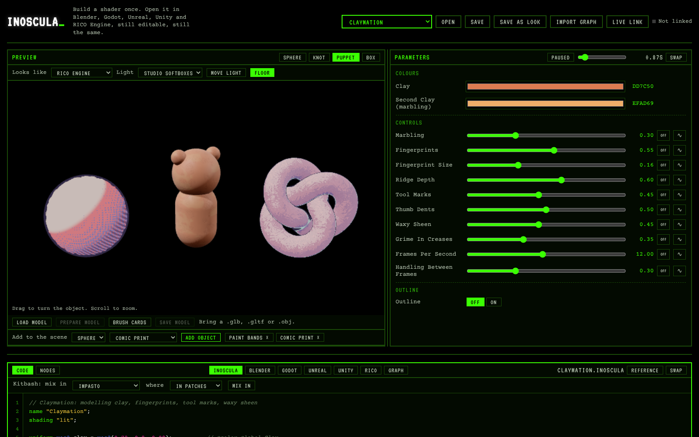

## Start here

You do not need to know how to code, and there is nothing to install.

1. Download INOSCULA and unzip it anywhere, a flash drive included (see Quick start below).
2. Double-click `dist/inoscula-studio.html`. It opens in your web browser and works with no internet.
3. Pick a look from the Look list at the top, then move the sliders on the right. The viewport follows.
4. Open the Code tab and change one number, for example a color. It rebuilds as you type.
5. Open the Check tab to see how the shader will look in each program.
6. Pick your program next to the tabs (say Unreal), follow the steps it shows, and press Save file.
7. Then follow "Step by step, for complete beginners" below to put it on a model.

The tour shows you around the first time you open the Studio, and Help (F1) is always one click away.

## The look library

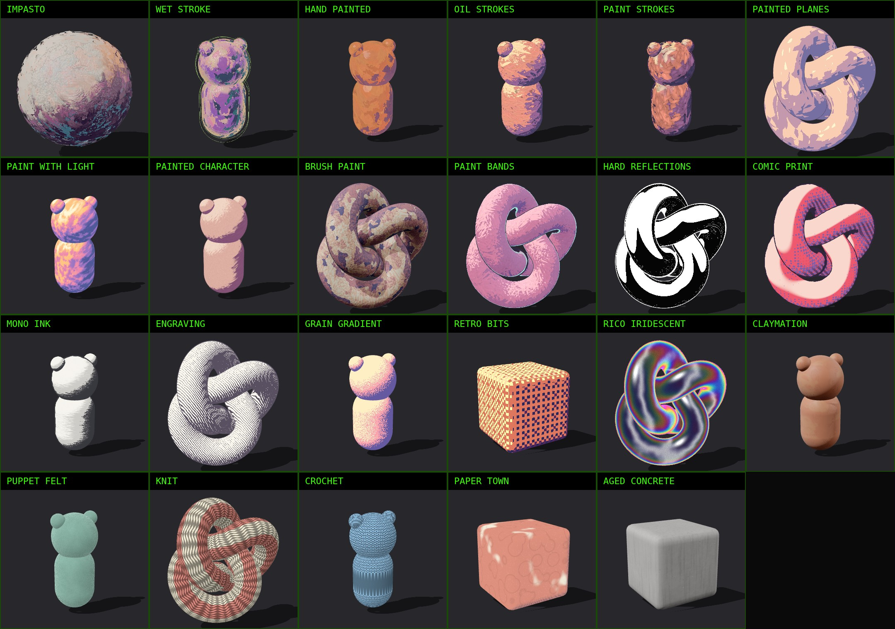

Twenty-three looks come with INOSCULA, each one written as code you can read, change and learn from in `looks/`.
The sheet above is rendered live through the RICO Engine adapter, and every look exports to every program.

| Look | What it does | Kind |
|---|---|---|
| Impasto | Thick oil on canvas. Short dragged dabs run around every form as the eye sees it (rings on a sphere, swirls in an eye socket), in two coats, each dab standing up with a lit upper edge and a shadowed lower one. A warm key and a cool fill are painted from a small palette, with value steps at dab edges, a broken silhouette with a raised crest and a dark edge, and canvas weave in the lights. Drift and Repaint animate it. It is lit, so the renderer's light rakes across real paint relief, and it follows the scene's sun or two placed lights | Painterly, lit, cards |
| Wet Stroke | Wet, reflective paint. Strokes follow every form, each with its own normal and depth, and light falls in two or three painted tones with a cool undertone in shadow and a warm overtone in light. Oily reflection colors and a violet to orange angle sheen are tinted by the light, with an eroded silhouette, a pale outer rim and two offset outlines that can be solid, broken or in fragments | Painterly, lit, shells |
| Hand Painted | Painted rather than rendered light, with no sheen. Values sit in a few broad strokes, with warm light and cool, saturated shadows, a hot band where light turns to shadow, bounce light from below, a cool rim, painted highlight dabs, crevice accents and paper grain | Painterly |
| Oil Strokes | Painted in 3D on brush cards. Every stroke is a lifted card with a tapered, bristled, dry-tailed stroke, lit as one flat plane and cut into painted values, so strokes overlap and break the silhouette | Painterly, cards |
| Paint Strokes | Coats of long strokes laid one over another, each casting a little shadow on the paint beneath, with stroke-driven toon values, wet reflection color and an eroded silhouette | Painterly |
| Painted Planes | Each stroke tilts the normal its own way, and the light picks from a base color and three accents, with highlights in a palette color | Painterly |
| Paint With Light | White light turns into color through a painted spectrum, with stroke scale, rotation, complexity and crunchiness | Painterly |
| Painted Character | Light split into highlight, midtone and shadow masks, each filled with its own brush and broken at its edge by it | Painterly |
| Brush Paint | Faceted planes, brush strokes and an ink outline | Painterly, lit |
| Paint Bands | Sunlight in flat painted bands with directional brush strokes, sky light, painted shadow shapes, a rim and an ink outline on twos | Stylized |
| Hard Reflections | Black and white glass or chrome, with hard hotspots from fake lights, a hard rim and scribbles. The dark body is real see-through glass that bends what is behind it and splits it into color at the edges | Stylized, glass |
| Comic Print | Halftone dots, hatching, off-register ink and a boiling outline | Stylized |
| Mono Ink | Black ink masses, dry brush and a wobbling brush outline | Stylized |
| Engraving | Cross-hatching whose weight follows the light | Stylized |
| Grain Gradient | Flat color bands with a speckled, grainy blend | Stylized |
| Retro Bits | Pixel art shading in 8, 16 or 32 bit color, with square pixels on the object, stepped light, ordered (Bayer) dithering and the color depth of each era | Stylized |
| RICO Iridescent | Chromatic glass with rainbow bands on the edges, sheen, a hot rim and grain | Stylized |
| Claymation | Modeling clay, lit. Real fingerprint ridges loop around a core, pressed in two overlapping layers, with a marbled second color, dragged tool scrapes and thumb dents, grime in creases, a soft waxy sheen with subsurface glow, and handling that shifts between frames | Craft, lit |
| Puppet Felt | Matted felt with fuzz | Craft |
| Knit | Stockinette stitches and stripes | Craft |
| Crochet | Rows of round stitches | Craft |
| Paper Town | Washi paper, woodblock color and folds | Craft |
| Aged Concrete | Pits, rain stains, moss and a damp line | Surface, lit |

### Impasto, in a few palettes

Thick, directional oil strokes follow every form, in two or three painted tones. The color shifts with the light
rather than just getting darker, and loose outlines can float around each shape.

| | |
|---|---|
| 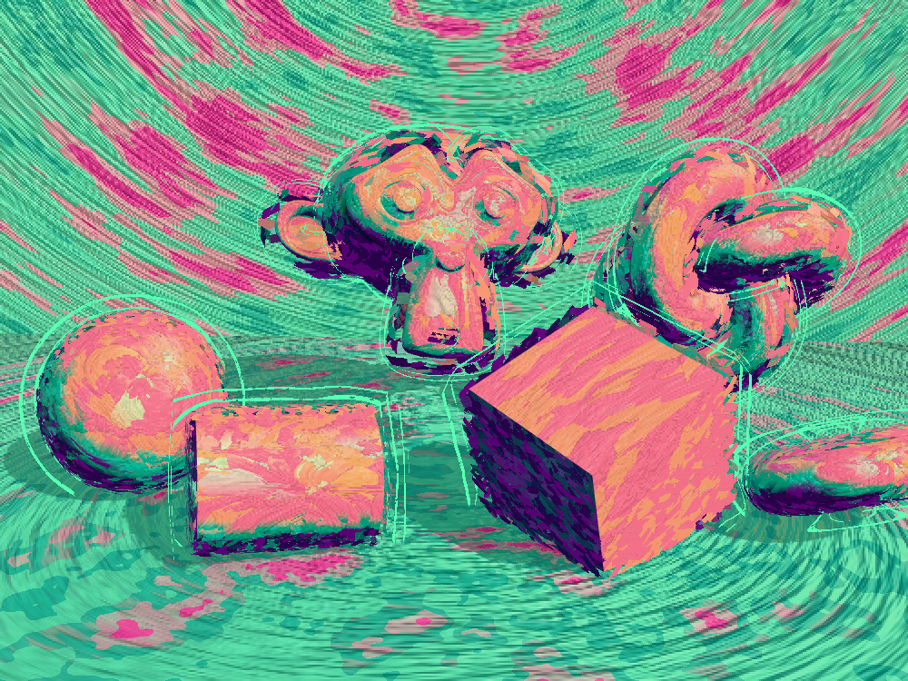 | 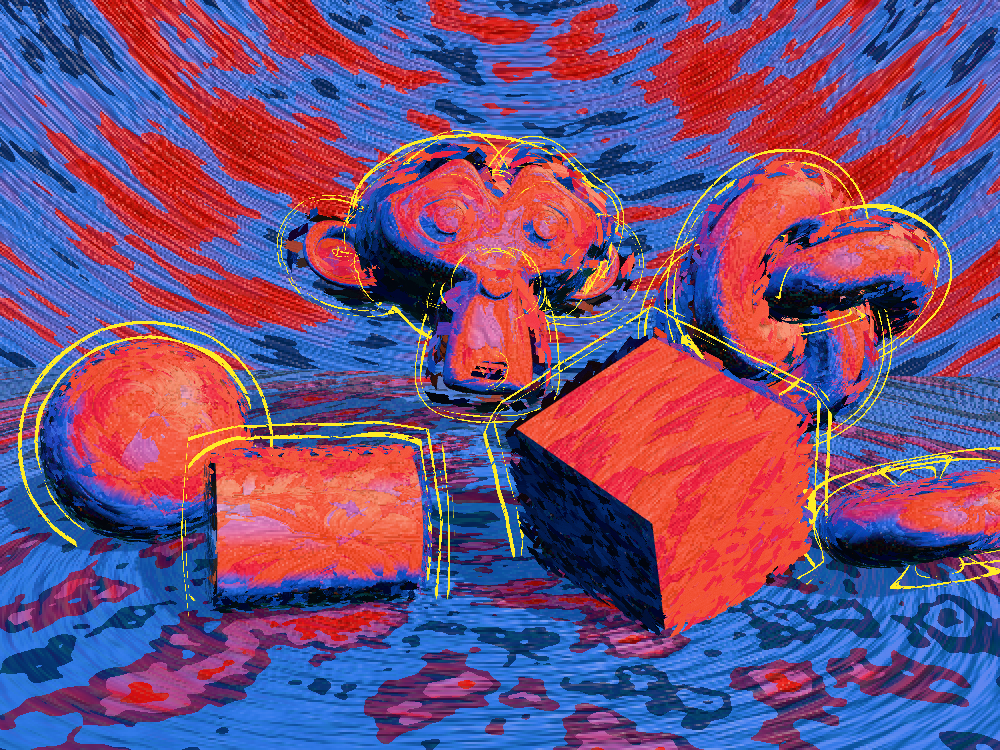 |
| Pink and green, three tones, on a painted backdrop in the inverted palette | Red, blue and black with yellow floating outlines |
| 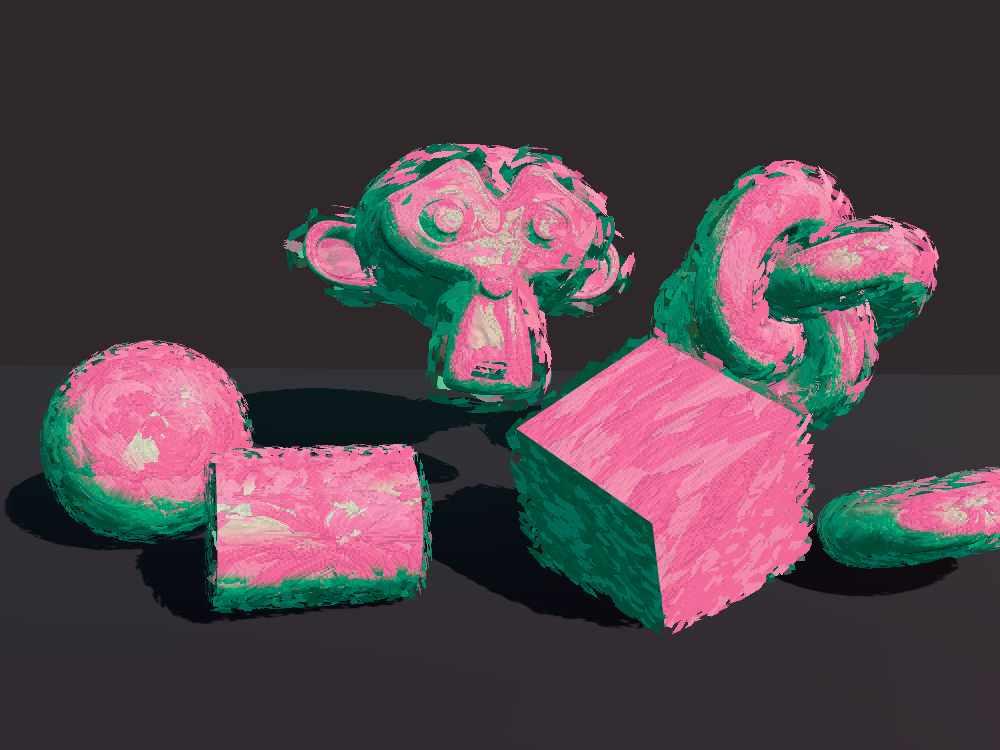 | 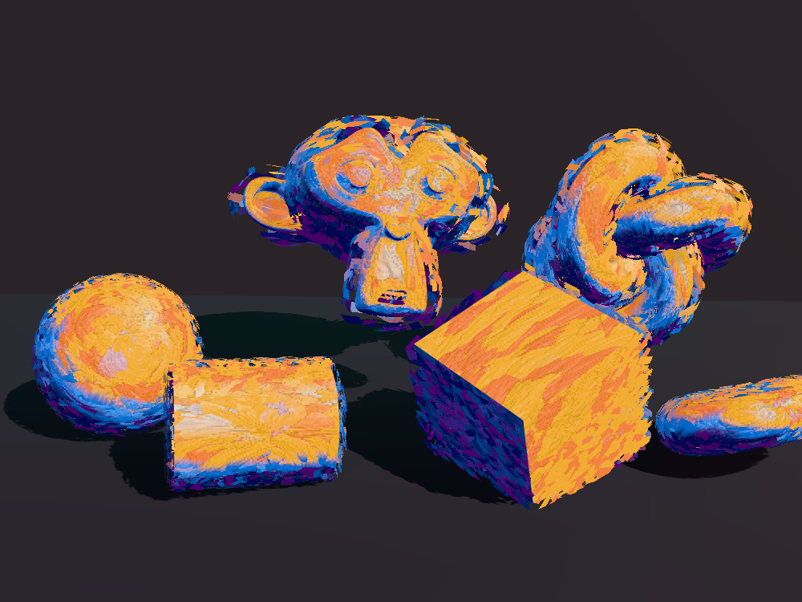 |
| Pink and green, two tones, on a dim plain backdrop | Cobalt and tangerine, three tones |
| 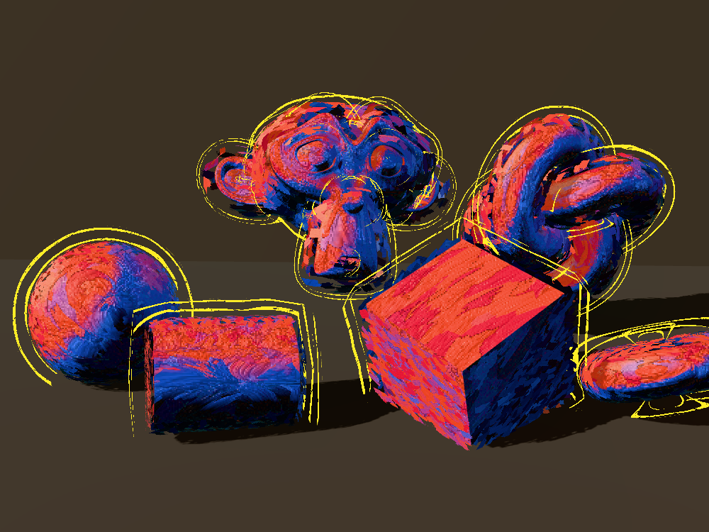 | 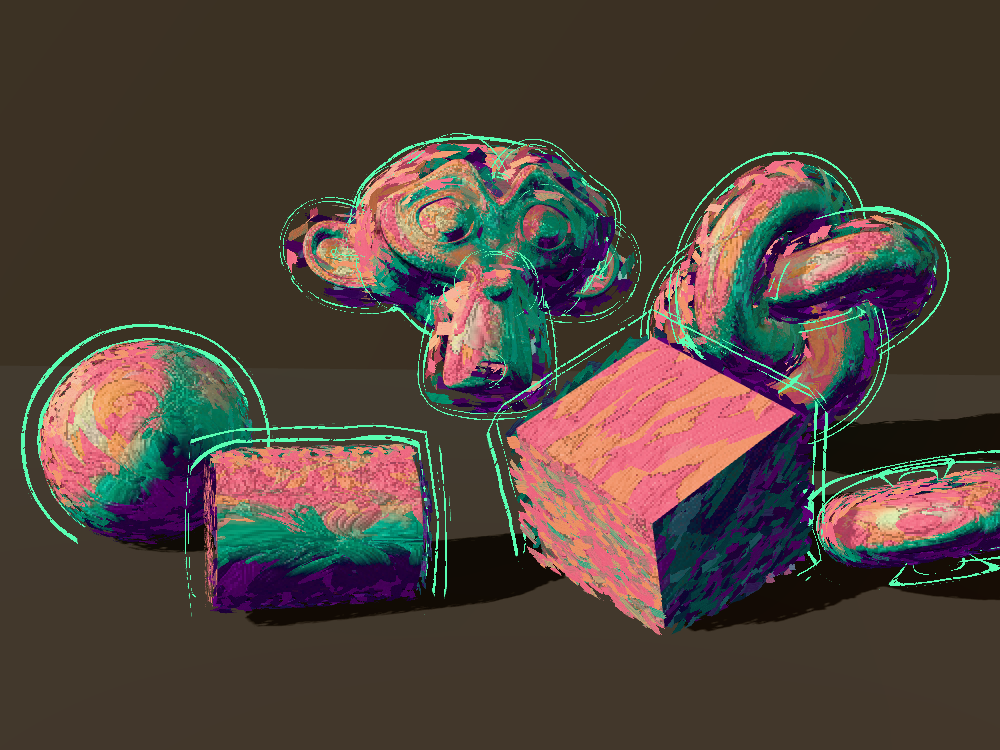 |
| Lit mostly by the renderer, with real shadows across the paint | The same with the pink and green palette |

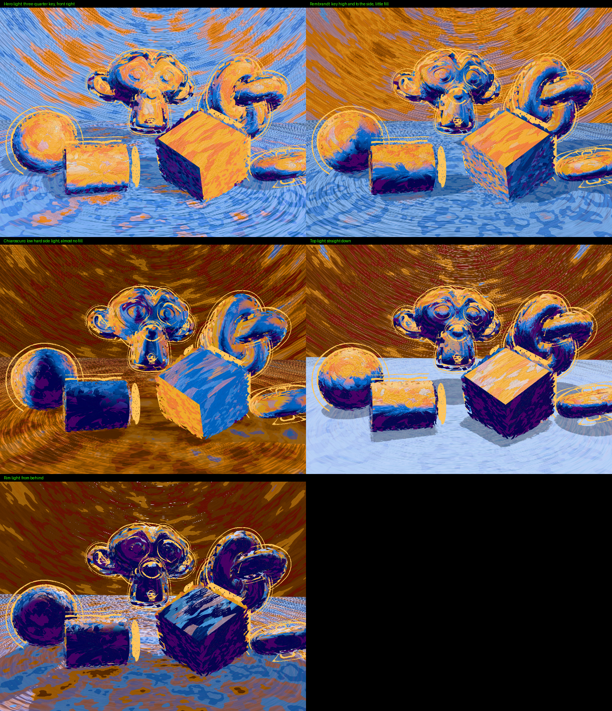

Hero, Rembrandt, chiaroscuro, top and rim light. The palettes are in `palettes/`.

## Bring a shader you already have

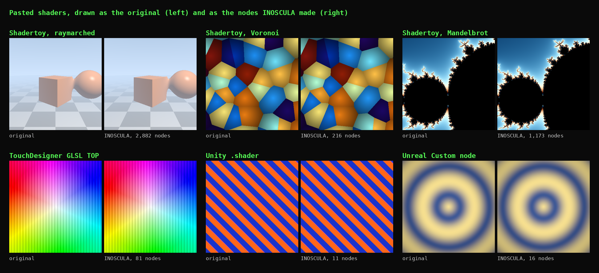

Paste a GLSL or HLSL pixel shader into the Studio code editor, or drag its file onto `Convert A Shader.bat`. It
turns into nodes for every program right away, and it updates as you type. In the picture above, each shader is
drawn twice in the browser, once as the original and once as the nodes INOSCULA built from it. These all work as
they are.

- **Shadertoy** (`mainImage`), **The Book of Shaders**, **GLSL Sandbox**, **three.js** `ShaderMaterial` code
  and plain GLSL fragment shaders, old (`gl_FragColor`) or new (`out vec4`)
- **TouchDesigner** GLSL TOP code, including `vUV`, `uTDOutputInfo`, the `uTD2DInfos` arrays, `uTDPass`,
  `TDOutputSwizzle`, `TDDither`, `TDHSVToRGB` and `TDRGBToHSV`. TouchDesigner's own `TDPerlinNoise` and
  `TDSimplexNoise` exist only inside TouchDesigner, so INOSCULA points you to `noise(p)` instead.
- **HLSL** pixel shaders (`: SV_Target`), with `cbuffer`s, structs, `mul()`, `lerp`, `saturate` and the rest
- **Unity** `.shader` files, built-in or URP. The Properties become sliders with the same names and ranges.
- **Unreal Custom node** code. Paste what is in the node's Code box, and its inputs become sliders.
- Code written by hand, as long as it is a pixel shader in one of these languages

The status line under the editor says what it read the code as and lists any notes about it, each with a button
that takes you to its line. To use the Studio's own tools on it (outline, mixing in a look, adding a parameter),
press **Turn into Inoscula code**.

A pasted shader cannot do these yet.

- **Read pictures**, such as `texture()`, `tex2D()` or `iChannel0`. A node material cannot read a picture from a
  shader yet, so the message names the line and suggests a pattern such as `noise(p)` instead.
- **Vertex shaders.** Only the pixel part (the fragment shader) turns into nodes.
- **Endless loops.** A loop with a fixed count runs in full, but one that only stops on a condition (a `while`
  loop, or a `for` with no fixed end) runs up to 128 steps, then stops there with a note.
- **Random numbers made with** `fract(sin(x) * 43758.5)`. They turn into nodes fine, but that trick rounds
  differently on each graphics card, so Blender shows a different random pattern while the look stays the same.
  Use `white_noise(p)` in its place for a pattern that matches everywhere. The note says which line.

Colors from Unity and Unreal are read in linear color, the way those programs work, and Shadertoy colors as they
look on screen, so the result looks the same as in the program it came from.

## Every program's own nodes

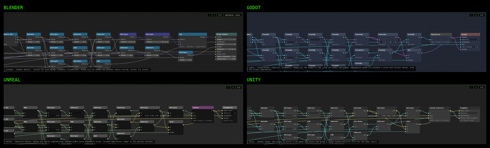

The Nodes view shows a shader the way each program shows it. Pick Blender and you see the Shader Editor nodes the
Blender export builds, socket for socket, and one level up, the material around the group. Pick Godot and you see
the VisualShader the Godot tab saves as a `.tres`. Unreal shows native material expressions, and Unity shows the
Shader Graph nodes. Maths become each program's own maths nodes one for one. Blender's noise, Voronoi and color
ramps, which no other program has, become one small code node each that runs Blender's own maths, so the pattern
is the same everywhere. Zoom with the wheel, drag to move around, and press Fit to see it all.

The Code view does the same for code. It shows the Inoscula source, the Blender script, the Godot `.tres` or
`.gdshader`, the Unreal script (native nodes, one Custom node or a Material Function) and the Unity shader (a
drop-in `.shader`, or a Custom Function file for Shader Graph), ready to copy, save or send over the live link.

## Export and import, program by program

### 1. Export

There are two ways to get a shader out of INOSCULA, and both give you the same files.

- **From the Studio.** Open `dist/inoscula-studio.html`, pick a look or paste your shader, then pick your program
  in the row of tabs next to Code, Nodes, Check and Scripts (Blender, Godot, Unreal, Unity, RICO). The panel shows
  the steps for that program. Press **Save file**, or **Copy** to paste it somewhere yourself. File, Export does
  the same.
- **With the converter (Windows).** Drag a shader file (`.inoscula`, `.inoscula.json`, `.glsl`, `.frag`,
  `.hlsl` or `.shader`) onto `Convert A Shader.bat`. When it is done, the `out` folder opens with one folder per
  shader.

| File | For |
|---|---|
| `name.blender.py` | Blender, as native Shader Editor nodes |
| `name.tres` | Godot, as VisualShader nodes |
| `name.gdshader` | Godot, as shader code (glass looks come as code only) |
| `name.outline.gdshader` | Godot, the outline, for looks that have one |
| `name.unreal.py` | Unreal, as native material nodes |
| `name.unreal-custom.py` | Unreal, as one Custom node (the simpler form, if the native nodes will not build) |
| `name.shader` | Unity, as a drop-in shader with its sliders, lighting and outline |
| `name.unity.hlsl` | Unity Shader Graph, as a Custom Function file |
| `name.outline.shader` | Unity Shader Graph, the outline as its own material, for looks that have one |
| `name.three.json` | three.js and RICO Engine |
| `inoscula_light_bridge.gd` | Godot, so looks that use the light direction follow your sun |

If your look uses object data (curvature and crevices, brush cards or shells), first load your model into the
Studio with **Model...**, press **Prepare model**, then **Save model**. Use that `.glb` in your program in place of
the original model.

### 2. Import

**Blender (4.2 or later)**

1. Import your model (File, Import, glTF for a `.glb`) and select it.
2. Open the **Scripting** workspace. In the Text Editor, press Open and pick `name.blender.py`.
3. Press **Run Script**. The material and its node group appear, with every slider on the group node, and the
   material goes on the selected objects (Ctrl+Z takes it off).
4. For looks that use the light direction, add a Sun light and rename it `RICO Sun`.
5. For brush cards or shells, keep the model selected and run `importers/inoscula_cards_blender.py` or
   `importers/inoscula_shells_blender.py` the same way.
6. Glass looks (Hard Reflections) show what is behind the object, so put something behind it. In Cycles the
   viewport starts grainy and clears up as it renders more samples.

**Godot (4.4 or later)**

1. Copy `name.tres` (or `name.gdshader`) into your project folder.
2. Select your mesh, and in the Inspector make a **New ShaderMaterial** under Material Override (or the surface
   material). Set its Shader to the file. The sliders appear in the Inspector under Shader Parameters.
3. For looks with an outline, make a second ShaderMaterial from `name.outline.gdshader` and set it as the first
   material's **Next Pass**.
4. For looks that use the light direction, add `inoscula_light_bridge.gd` to any node and point it at your
   DirectionalLight3D.

**Unreal (5.4 or later)**

1. Turn on the **Python Editor Script Plugin** (Edit, Plugins), then restart Unreal.
2. Import your model. For a `.glb` from the Studio, set Import Vertex Color to Replace.
3. Drag the model into the level and select it.
4. Run `name.unreal.py` with **Tools, Execute Python Script**. It builds `/Game/Inoscula/M_name` from native
   nodes, makes the Material Instance `MI_name`, and puts it (and the outline, for looks that have one) on the
   selected objects. The Output Log says how many meshes it put it on.
5. Move the sliders in `MI_name`. If the native nodes will not build, run `name.unreal-custom.py` instead.

**Unity (URP, Unity 6, Windows or Mac)**

1. Make or open a project with the **Universal 3D** template.
2. Drag `name.shader` into the **Project** window.
3. Right-click the shader and choose **Create, Material**, then drag the material onto your model. The sliders are
   on the material in the Inspector, and the look lights from the scene's Directional Light.
4. Check that Edit, Project Settings, Player, Other Settings, Color Space is **Linear** (the default for new URP
   projects).
5. For a `.glb` from the Studio, add glTF support with Window, Package Manager, +, Add package by name,
   `com.unity.cloud.gltfast`. Other models work as FBX or OBJ.

**RICO Engine and three.js**

RICO renders with three.js, so the adapter in `src/rico.ts` turns a shader into a live material with
`inosculaMaterial(THREE, graph)`. Over the live link, RICO gets every slider as OSC on port 9000.

### 3. Check it

Set **Preview as** in the Studio to your program to see it with that program's tonemapping, and open the Check
tab to see how closely it will match. `docs/TESTING.md` has a full test for each program.

## Step by step, for complete beginners

These steps start from nothing and end with a look on a model. Try a plain sphere first, then your own model.
The Studio's file for each program is the one in the table above (Save file in that program's tab).

### Blender

1. Download Blender (4.2 or later) from blender.org and open it. The start scene has a cube in it.
2. Make a smooth ball to test on. Hover over the 3D view, press **Shift+A**, then Mesh, then UV Sphere. Right-click
   the sphere and choose **Shade Smooth**. For your own model, use File, Import, glTF (for a `.glb`) instead.
3. Click the object so it has an orange outline. The material goes on whatever is selected.
4. At the top of the window, click the **Scripting** tab. In the Text Editor in the middle, press **Open**, pick
   `name.blender.py`, then press **Run Script** (the play button).
5. Go back to the **Layout** tab. In the top right of the 3D view there are four small sphere icons. Click the
   fourth one (Rendered). The look now shows on the object.
6. To change it, open the **Shading** tab and click the object. The big group node holds every slider.
7. For looks that use the light direction, press **Shift+A**, then Light, then Sun. In the Outliner (top right),
   double-click the sun and rename it `RICO Sun`, then run the script once more.

For glass looks (Hard Reflections), put something with color behind the object, for example **Shift+A**, Mesh,
Monkey, moved behind it. The glass shows what is behind it, so on a plain gray floor it looks gray. In Cycles the
view starts grainy and clears up. In Eevee, glass seen through other glass shows the world color, so keep glass
objects apart or render in Cycles (Properties, Render, Render Engine).

### Godot

1. Download Godot (4.4 or later) for your computer from godotengine.org. Unzip it and double-click the program.
   Nothing needs installing.
2. In the Project Manager, press **Create**. Give the project a name, pick an empty folder, keep **Forward+** and
   create it.
3. In the **Scene** panel on the left, click **3D Scene**.
4. Press the **+** at the top of the Scene panel, search `MeshInstance3D` and press Create. In the **Inspector** on
   the right, click the empty **Mesh** slot and choose **New SphereMesh**. For your own model, drag the `.glb` into
   the FileSystem panel (bottom left), then drag it from there into the 3D view.
5. Drag `name.gdshader` (or `name.tres`) from your computer's folder into the **FileSystem** panel.
6. Click the sphere in the Scene panel. In the Inspector, open **Geometry**, click the empty **Material Override**
   slot and choose **New ShaderMaterial**.
7. Click the new ShaderMaterial to open it. Drag the shader file from FileSystem onto its **Shader** slot. The
   sliders appear under **Shader Parameters**.
8. For looks with an outline, click the empty **Next Pass** slot of that material, choose **New ShaderMaterial**
   and give it `name.outline.gdshader` the same way.
9. For looks that use the light direction, add a `DirectionalLight3D` with the **+**. Drag
   `inoscula_light_bridge.gd` from FileSystem onto the top node in the Scene panel and pick your light in its
   **Light** slot. Press Ctrl+S, then Scene, Reload Saved Scene, so the bridge starts running in the editor.

For glass looks, add a second MeshInstance3D with **New BoxMesh** behind the sphere (Transform, Position Z `-3`).

### Unreal

1. Install Unreal Engine (5.4 or later) from the Epic Games Launcher and make a new blank project.
2. Turn on Python once. Edit, Plugins, search `Python Editor Script Plugin`, tick it and restart Unreal.
3. Put a shape in the level. In the toolbar, click the add button (a cube with a green plus), then Shapes, then
   Sphere. For your own model, drag the `.glb` or `.fbx` into the Content Browser (for a `.glb` from the Studio,
   set Import Vertex Color to Replace), then drag it from there into the level.
4. Click the object in the level so it is selected.
5. Tools, **Execute Python Script**, and pick `name.unreal.py`. It builds the material and puts it on the selected
   object. The Output Log (Window, Output Log) says how many meshes it put it on.
6. The sliders are in `MI_name` in the Content Browser, in the Inoscula folder. Double-click it and move them.
   Looks that use the light direction have an **Inoscula Light Direction** slider there. Unreal does not feed it
   from your sun, so set it to point the way your light comes from.
7. If the script reports an error, run `name.unreal-custom.py` the same way. It is the simpler form.

### Unity

1. Install **Unity Hub** from unity.com/download and open it. Sign in (a free Personal account is fine).
2. In the Hub, open **Installs**, press **Install Editor** and pick the newest **Unity 6** with LTS next to it.
   This is a large download. When it finishes, the editor sits in `C:\Program Files\Unity\Hub\Editor`.
3. Open **Projects**, press **New project**, pick the **Universal 3D** template, name it and press Create project.
4. Put a shape in the scene. In the **Hierarchy** on the left, right-click, then 3D Object, then Sphere.
5. Drag `name.shader` from your computer's folder into the **Project** window at the bottom.
6. Right-click the shader in the Project window and choose **Create, Material**.
7. Drag the new material onto the sphere in the Scene view. The sliders are on the material in the Inspector,
   and the look lights from the scene's Directional Light.
8. For your own model, drag an `.fbx` or `.obj` into the Project window, then into the Scene. For a `.glb` from the
   Studio, first add glTF support with Window, Package Manager, +, Add package by name, `com.unity.cloud.gltfast`.

Glass looks are not see-through in Unity yet. They show their colors only.

### When nothing shows

- **The object is plain gray or white.** The material is not on it. Select the object and run the script again
  (Blender, Unreal), or check the Material Override slot (Godot) or the material on the object (Unity).
- **Blender shows no color at all.** The 3D view is in Solid mode. Pick the fourth sphere icon (Rendered).
- **Godot shows the object blank or wrong.** Open the shader file in Godot. If it did not compile, the shader
  editor at the bottom names the line.
- **Unity shows a pink object.** The project is not a Universal 3D (URP) project. Make a new one with that
  template.
- **The look ignores your light.** In Blender, add a sun and run the script again. In Godot, add the light
  bridge. In Unreal, set **Inoscula Light Direction** in `MI_name` by hand. Unity uses the scene's Directional
  Light by itself.

## What you can make

- **Stylized looks that match to the pixel.** Unlit shaders compute the same color in every tool, from comic
  print, painted light bands, hard ink reflections and claymation to engraving and a set of painterly looks.
- **Lit materials, lit by each tool's own renderer.** Lit shaders output base color, roughness, metallic, bumps
  and emission, plus coat, sheen and subsurface layers. Blender lights them with the Principled BSDF, Unreal with
  Default Lit or a Substrate Slab, Godot and Unity with their standard lit models, and RICO with three.js's
  physical material.
- **Looks that adapt to the object.** `object_size` tells a shader how big the object is, so painterly looks keep
  the same number of strokes on a pebble and on a building. Strokes follow each form as the eye sees it and read
  the model's curvature and crevices. In RICO use `look.fitTo(obj)`. The Blender export and the Godot light
  bridge set it for you, and Unreal reads Object Radius.
- **Object based, never baked.** Every pattern is computed live on the object's own surface, so it moves, scales
  and reacts with the object. Edge wear and crevice grime read curvature and occlusion that INOSCULA Studio
  measures once and stores in the model.
- **Outlines outside the silhouette.** `outline`, `outline_color` and `outline_breakup` give an inked line around
  the shape, broken up with noise. It becomes a Solidify modifier in Blender, an Overlay Material in Unreal (put on
  the selected objects for you), a Next Pass in Godot, a second pass of the same material in Unity, and
  `look.addOutline(mesh)` in RICO.
- **Painted in 3D, with brush cards.** Brush cards lay thousands of single strokes over a model, each lifted just
  off the surface and following the form, so strokes overlap, stand proud of the paint underneath and break the
  silhouette. A look made for cards (Oil Strokes) draws one stroke on each card. Cards are plain geometry.
  INOSCULA Studio adds them (Brush cards) and saves them into the model for every tool, Blender makes them
  natively with `importers/inoscula_cards_blender.py`, and RICO with `look.addCards(mesh)`.
- **Animated.** Any parameter can be keyframed in each tool (Blender keyframes, Unreal Sequencer, Godot
  AnimationPlayer). `time` drives motion inside the shader, and `floor(time * 12.0)` gives stop-motion stepping
  on twos.

## Four ways in

1. **Code** that reads like GLSL, with your own functions (see `looks/`).
2. **A shader you already have**, in GLSL or HLSL (see above).
3. **Blender nodes**, read in with `importers/blender_to_inoscula.py`.
4. **The graph** itself (`.inoscula.json`), the open format every tool shares.

Code and nodes are two views of one shader. INOSCULA Studio shows both and links each node to its line of code.

## Round trips, both ways

Every export carries its INOSCULA graph inside it, so a shader can go out and come back with your changes.

| From | How it comes back | What comes back |
|---|---|---|
| Blender | `importers/blender_to_inoscula.py` | Everything, including parameters and any node edits |
| Unreal | `importers/inoscula_from_unreal.py` (select the asset, run it) | Every parameter, from the material or a Material Instance |
| Godot | `node bin/inoscula-pull.ts material.tres shader.gdshader` | Every parameter set in the Inspector |
| Inoscula code | INOSCULA Studio | Everything |

So Unreal, then Blender, then back to Unreal works. Tweak in Unreal, pull, open in Blender, edit nodes, read back
and rebuild in Unreal. Changes made inside Unreal's Custom node code are the one thing that stays in Unreal.

## Live link

Move a slider in one program and the same material changes in all the others.

1. **Start the bridge.** Double-click `Live Link.bat` in the inoscula folder and leave its window open. (Without
   the .bat files, run `node bin/inoscula-live.ts`.) It listens on 9420 (INOSCULA Studio and web pages), 9421
   (Blender) and 9422 (Godot), and sends OSC on 9000.
2. **Blender.** Build the material (Blender tab, Run Script), then go to Edit, Preferences, Add-ons, Install from
   Disk, pick `importers/inoscula_live_blender.py` and tick it.
3. **Godot.** Use the Godot export as a ShaderMaterial and add `importers/inoscula_live.gd` to any node.
4. **Unreal.** Turn on the Remote Control API plugin. Select your object and run the INOSCULA script, which makes
   the Material Instance `MI_[Name]` and puts it on the object. Then open a Command Prompt in the inoscula folder
   (type `cmd` in the File Explorer address bar) and start the bridge with
   `"Live Link.bat" --unreal http://localhost:30010 --unreal-instance /Game/Inoscula/MI_[Name]`.
   Unreal 5.8 blocks outside calls until you allow them. Close Unreal, open your project's
   `Config/DefaultRemoteControl.ini` in Notepad (make it if it is not there) and add these two lines, then reopen
   Unreal and type `WebControl.StartServer` in the console (the Cmd box at the bottom).

   ```
   [/Script/RemoteControlCommon.RemoteControlSettings]
   +CustomAllowedRemoteFunctionCalls=(ClassPath="/Script/MaterialEditor.MaterialEditingLibrary")
   ```

   To check, open `http://localhost:30010/remote/info` in your browser. Text back means Unreal is listening.
5. **RICO Engine, or anything that speaks OSC.** It receives `/inoscula/[shader]/[parameter]` on port 9000.
6. **INOSCULA Studio.** Open `dist/inoscula-studio.html` from your computer, press the connection button at the
   top right (it says Offline), then Connect.

Parameters match by their labels, so keep the shader's name the same in every program.

### Other computers and other Studios

By default only your own computer can connect. To link a second machine on the same network, such as another
Studio or the laptop running the projection, double-click `Live Link Shared.bat` and pick a pass word (or run
`node bin/inoscula-live.ts --share --key tulip`). It prints an address such as `ws://192.168.1.20:9420`. On the
other computer, open the connection button at the top right and type in that address and the pass word. Give each
Studio a name there. Connected Studios see each other in the Connections window and can send each other a whole
shader, which opens on a new object after you accept it.

## INOSCULA Studio

`dist/inoscula-studio.html` is the whole tool in one file. Double-click it to open it in a browser, with nothing
to install, no account and no internet. It is laid out like a 3D program, so if you know Maya or Blender you
already know where things are.

- **Menus** along the top (File, Edit, Create, View, Window and Help), each with its shortcut next to it.
- **Outliner and Layers** on the left. Every object in the scene is listed. Click to select, double-click to
  rename, and use the eye to hide. Layers group objects so you can hide or show several at once.
- **The viewport** in the middle. Click an object to select it, then move (W), rotate (E) or scale (R) it with
  the gizmo. Q goes back to selecting, F frames it and A frames everything. Drag to orbit, right-drag to pan and
  scroll to zoom. Settings has Maya navigation (Alt and the mouse) if you prefer it. The axes in the corner show
  which way is up, and clicking one looks along it.
- **Attribute Editor** on the right, with the selected object's shader, its controls in sections you can fold,
  and the object's own position, rotation and scale. Each object keeps its own look.
- **The shader panel** at the bottom, with four tabs.
  - **Code** shows the shader, rebuilt as you type. A mistake marks its line and says what to write instead,
    with a button that takes you there.
  - **Nodes** shows the node graph each program gets, drawn the way that program draws it (Blender's Shader
    Editor, Godot's VisualShader, Unreal's Material Editor, Unity's Shader Graph). Double-click an Inoscula node
    to jump to its line of code.
  - **Check** builds the shader for every program, for real, and tells you for each one whether it will look the
    same, close, partly the same, or fail, and what to change.
  - **Scripts** holds small JavaScript programs that automate the Studio (see Scripts below).
- **Export.** Pick a program next to the tabs, read the steps, and press Save file or Copy. File, Export does the
  same.

Drag the edges between panels to resize them, press Space over any panel to fill the window with it, and use
Window, Reset the layout if it ever gets muddled. The layout fits itself to the window, from a large monitor down
to a laptop or a tablet, and on small screens the side panels slide in from the edges. View, Full screen
(Ctrl+Shift+F) hides the browser. Settings holds the size of the interface, navigation, the grid, floor and axis
gizmo, and your connection.

More in the Studio

- Preview on a sphere, knot, puppet, rounded box or **your own model** (.glb, .gltf, .obj), with several objects
  in one scene, each with its own look, to see how looks sit together under the same light.
- **Prepare model** measures curvature and occlusion and stores them in the model, and **Save model** writes a
  .glb with that data for every other tool.
- Preview profiles copy each tool's defaults (Blender AgX, Unreal filmic, Godot linear, Unity neutral), with
  three light setups and a floor with soft shadows. L lets you drag the light.
- Every control has an Off button to switch it off and back, and a wave button to animate it between its limits.
- **Save as look** keeps your edited shader in the look list under its own name.
- **Kitbash** mixes any look into the one you are editing, in patches, in the light, in shadow, on top, at the
  edges or in crevices. Its controls come along, so you can keep stacking looks.
- Exports for every tool, with Unreal as native nodes, one Custom node or a Material Function (to plug into your
  own materials, layer stacks or Substrate graphs), optionally ending in a Substrate Slab.

## Writing your own shaders

Shaders are written in **Inoscula code** and saved as `.inoscula` files. It reads like GLSL (the shader language of
the web and Godot), so if you know GLSL or HLSL most of it is familiar. It keeps to what every program's nodes can
do, because every line has to become real nodes in Blender, Godot, Unreal and Unity.

```
name "Rust";
shading "lit";

uniform vec3 base = vec3(0.5, 0.2, 0.1);  // @color @label Base
uniform float amount = 0.5;               // @range 0 1 @label Amount @group Wear
uniform float flakes = 1.0;               // @toggle @label Flakes @group Wear
uniform float finish = 0.0;               // @options Dull | Satin | Wet @label Finish

void main() {
  float n = noise(object_pos, 4.0, 3.0, 0.5, 2.0);
  color = mix(base, vec3(0.1), step(1.0 - amount, n) * flakes);
  roughness = mix(0.9, 0.2, finish / 2.0);
}
```

- Every `uniform` is a control, in the Studio and in every program. The note after `//` picks what kind. `@range
  lo hi` makes a slider, `@step 1` whole numbers, `@color` a color picker, `@toggle` a switch, `@options A | B` a
  menu, `@group Name` its own section, `@desc text` the tooltip and `@label Name` the name people see.
- You do not have to type these. **+ Add parameter**, under the controls, asks what kind of control you want
  (slider, whole number, switch, menu, color or direction), writes the line for you and shows how to use it.
- There are no loops and no if blocks, because node graphs cannot loop. Use `mix()`, `step()`, `smoothstep()` or
  `condition ? a : b`.
- **When something cannot be translated, INOSCULA says so.** Code that cannot become nodes everywhere stops with a
  message on its line saying what to use instead. Code that builds but looks a little different in a program (a
  renderer limit, for example) is listed in the Check tab with the reason and what to do. Nothing is dropped
  without telling you.

Help, Writing shaders and Help, Code reference in the Studio list everything you can write. `SPEC.md` has the
full language and every node, and `looks/` has every built-in look as code to learn from.

## Scripts

The Scripts tab runs JavaScript inside the Studio, to automate what you do often or to add your own buttons,
sliders, menu items and tabs. Three examples come with it (random colors, a turntable button and export
everything). Tick Run when the Studio opens to keep what a script adds. Running a script again first removes what
it added last time, so you can edit and rerun freely.

```js
// a toolbar button that saves the shader for every program at once
inoscula.ui.addButton('Export all', () => {
  for (const kind of ['blender', 'godot', 'unreal', 'unity']) inoscula.saveExport(kind)
})
```

A script can read and change the code (`inoscula.code`), the controls (`inoscula.params`), the objects
(`inoscula.scene`) and the looks (`inoscula.looks`). It can export (`inoscula.export`, `inoscula.saveExport`),
save files, listen for events (`inoscula.on('compile' | 'frame' | 'select' | 'param', fn)`) and add interface
(`inoscula.ui.addButton`, `addSlider`, `addMenuItem`, `addTab`). Help, Scripting lists every call. Scripts are kept
in the browser, and Export saves one as a .js file to share. Only run scripts you trust.

## Offline, always

Everything above works with no internet. The Studio is one file with its fonts and libraries inside it, and the
converter and bridge run on your own computer. Connections are only ever to programs and computers you choose, on
your own network.

## Render check, what it really looks like in each tool

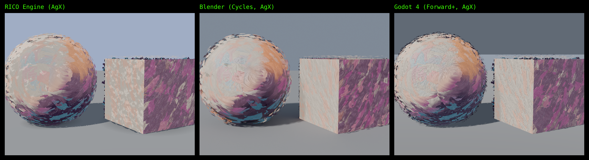

`node bin/inoscula-check.ts looks/oil-paint.inoscula --godot path/to/godot` renders the shader in RICO, in real
Blender (Cycles) and in real Godot, in one test scene (same camera, sun, sky and AgX tonemapping), and saves the
pictures side by side. These are real renders from each program, not previews.

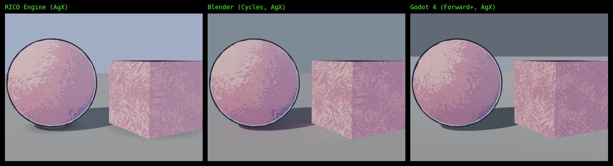

## How exact it is

Each shader is drawn onto the same sphere and compared texel by texel with Blender's own bake, with the same
inputs on both sides (Blender records the exact position, normal and UV it used at every texel).

| Shader | Identical 8-bit color |
|---|---|
| Ink Wash, Kitchen Sink, Claymation, RICO Iridescent | 100% |
| Voronoi (distance, cell color, position) | 100%, zero difference |
| Grain Gradient | 99.96% |
| Toon Bands, Comic Print, Engraving | 96 to 97%, and 99.98 to 100% within 2/255 |

As Godot 4.5 draws them, every look is 99.85 to 100% within 2/255 except Engraving (98%). Godot's VisualShader
(the node version) draws every look the same as Godot's code version, to within 1/255 for looks that hold still.
A material built by hand in Blender, imported and run in RICO, is 99.9% identical. Noise, White Noise and Voronoi
are ports of Blender's own code, including its integer hashes, and color ramps reproduce Blender's 257 entry
lookup table.

Pasted shaders are checked the same way. Every GLSL and HLSL test shader in `test/glsl` and `test/hlsl` is drawn
as the original and as INOSCULA's nodes, and each one matches on at least 99% of pixels to within 2/255.

## Quick start

**Windows, nothing to install.** Download `inoscula-windows.zip` from the Releases page and unzip it anywhere, a
flash drive included. It has Node (the program that runs INOSCULA's tools) built in, in the `runtime` folder.

- `dist/inoscula-studio.html` is INOSCULA Studio. Open it in your browser.
- `Convert A Shader.bat` takes a shader file dragged onto it. The Blender, Godot, Unreal, Unity and three.js
  versions land in the `out` folder, which opens when it is done.
- `Live Link.bat` starts the live link. Leave its window open, and close it to stop.
- `Live Link Shared.bat` does the same for other computers on your network too. It asks for a pass word.
- **On a Mac**, open `dist/inoscula-studio.html` in Safari or Chrome. Paste or open your shader there and save each
  program's version from its tab. The .bat files are for Windows only.

If you got INOSCULA from the code instead (Code, Download ZIP, or git), the `runtime` folder has no Node in it. The
.bat files then use the Node installed on your computer, which needs to be 22.18 or newer, with no packages to
install. From a terminal

```
node bin/inoscula.ts looks/claymation.inoscula --out out           # every target, from code
node bin/inoscula.ts examples/ink.inoscula.json --out out          # or from a graph
node bin/inoscula-check.ts looks/oil-paint.inoscula --godot godot   # real renders side by side
node bin/inoscula-live.ts                                        # the live link
```

See `docs/TESTING.md` for a step by step test in each program, and `SPEC.md` for the format and every node.

## Limits (version 0.3)

- **Measured.** Blender (Cycles), Godot 4.5 (Forward+, both the code shader and the VisualShader), three.js r170
  (RICO's version) and INOSCULA Live with real Blender. **Unreal.** The native node scripts have been built and
  checked by hand in Unreal 5.8 (Hard Reflections, Mono Ink), and every look's script is also run against
  Unreal's documented Python API in the tests, but not every look has been checked by eye in Unreal yet.
  **Unity** has not been run in Unity yet. Every look's drop-in `.shader` compiles with every pass against Unity's
  own URP shader code (Unity 6.0 and 6.3, Windows and Mac settings). The HLSL passes the Khronos reference compiler
  in material, Material Function and Substrate form. `docs/TESTING.md` says how to test each one.
- **TouchDesigner** code is read and checked in the browser against TouchDesigner's documented GLSL TOP inputs.
  It has not been checked inside TouchDesigner itself yet.
- **Eevee** uses the same nodes as Cycles but was not measured separately. Its glass does not show other glass
  behind it.
- **Glass** (Hard Reflections) is see-through in Blender, Godot, Unreal and RICO. In Unity it shows its colors
  only.
- **Rim and outline shells** (Wet Stroke) are made in INOSCULA Studio, RICO (`look.addShells(mesh)`) and Blender
  (`importers/inoscula_shells_blender.py`). For Godot, Unreal and Unity, bring the model saved from INOSCULA
  Studio.
- **Brush cards** are made in INOSCULA Studio, RICO and Blender. For Godot, Unreal and Unity, bring the model with
  its cards saved from INOSCULA Studio (or from Blender as .glb). Each tool's cards are its own random set, so the
  strokes land in different places, with the same look.
- **Not yet.** Image textures and normal maps (brush strokes are made with maths for now), displacement of the mesh
  itself, more pattern nodes (wave, brick, gradient), and Unity pull back.
- Lit materials match as materials. The lighting is each renderer's own, as it should be.

## License

INOSCULA is free software under the GNU Affero General Public License, version 3 or later (AGPL-3.0-or-later, see
LICENSE).

- You can use it for anything, including paid and client work.
- If you share INOSCULA or a changed copy of it, you share its full source under the same license. If you run a
  changed copy for other people over a network (a hosted Studio, for example), you offer them its source.
- **What you make with it is yours.** Your shaders, your scripts and every file INOSCULA exports for you are not
  covered by the license. Use, sell and share them under any license you like, even closed ones (see
  LICENSE-EXCEPTIONS.md).
- The noise is a port of Blender's Cycles noise, under the Apache License 2.0 (see NOTICE). Fonts in
  `studio/fonts` are under the SIL Open Font License.
