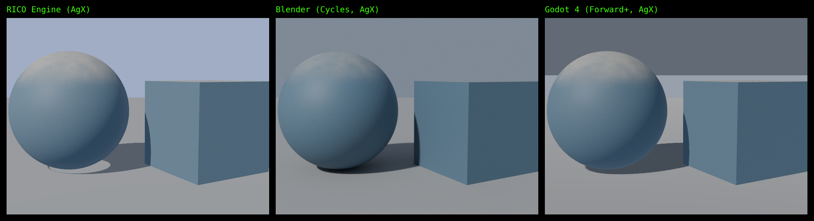
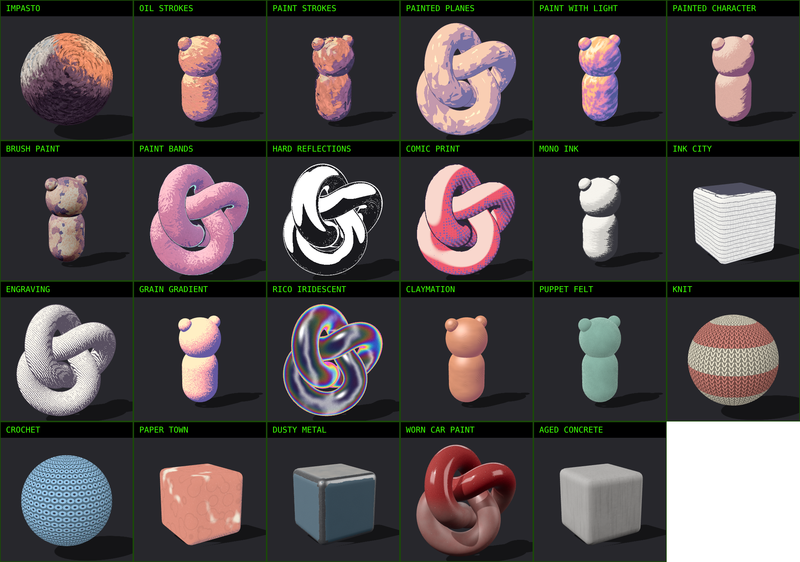

# Inoscula

*Inosculation: when two branches grow into each other and become one.*

Build a realtime shader once. Open it in Blender, Godot, Unreal, Unity and RICO Engine as native, editable
material, with the same look, the same parameters and a live link between them all.


## What you can make

- **Stylised looks that match to the pixel.** Unlit shaders compute the same colour in every tool: comic
  print, painted light bands, hard ink reflections, claymation, felt, knit, crochet, paper, engraving.
- **Realistic materials, lit by each tool's own renderer.** Lit shaders output base colour, roughness,
  metallic, bumps and emission, plus coat, sheen and subsurface layers. Blender lights them with the Principled
  BSDF, Unreal with Default Lit or a Substrate Slab, Godot and Unity with their standard lit models, RICO with
  three.js's physical material. Dust, scratches, chipped paint, grime, flakes, moss, stains.
- **Adapts to the object.** `object_size` tells a shader how big the object is, so painterly looks keep the
  same number of strokes on a pebble and on a building; strokes follow each form as the eye sees it and read
  the model's curvature and crevices. RICO: `look.fitTo(obj)`; the Blender export and the Godot light bridge
  set it for you; Unreal reads Object Radius.
- **Object based, never baked.** Every pattern is computed live on the object's own surface, so it moves,
  scales and reacts with the object. Edge wear and crevice grime read curvature and occlusion that Inoscula Studio
  measures once and stores in the model.
- **Outlines outside the silhouette.** `outline`, `outline_color` and `outline_breakup` give an inked line
  around the shape, broken up with noise: a Solidify modifier in Blender, an Overlay Material in Unreal, a Next
  Pass in Godot, a second material in Unity, `look.addOutline(mesh)` in RICO.
- **Painted in 3D, with brush cards.** Brush cards lay thousands of single strokes over a model, each lifted
  just off the surface and following the form, so strokes overlap, stand proud of the paint underneath and
  break the silhouette. A look made for cards (Oil Strokes) draws one stroke on each card. Cards are plain
  geometry: Inoscula Studio adds them (Brush cards) and saves them into the model for every tool, Blender makes
  them natively with `importers/inoscula_cards_blender.py`, RICO with `look.addCards(mesh)`.
- **Animated.** Any parameter can be keyframed in each tool (Blender keyframes, Unreal Sequencer, Godot
  AnimationPlayer). `time` drives motion inside the shader, and `floor(time * 12.0)` gives stop-motion
  stepping on twos.

## Three ways in

1. **Code** that reads like GLSL, with your own functions (see `looks/`).
2. **Blender nodes**, read in with `importers/blender_to_inoscula.py`.
3. **The graph** itself (`.inoscula.json`), the open format every tool shares.

Code and nodes are two views of one shader. Inoscula Studio shows both and links each node to its line of code.

## Round trips, both ways

Every export carries its Inoscula graph inside it, so a shader can go out and come back with your changes:

| From | How it comes back | What comes back |
|---|---|---|
| Blender | `importers/blender_to_inoscula.py` | Everything: parameters and any node edits |
| Unreal | `importers/inoscula_from_unreal.py` (select the asset, run it) | Every parameter, from the material or a Material Instance |
| Godot | `node bin/inoscula-pull.ts material.tres shader.gdshader` | Every parameter set in the Inspector |
| Inoscula code | Inoscula Studio | Everything |

So Unreal, then Blender, then back to Unreal works: tweak in Unreal, pull, open in Blender, edit nodes, read
back, rebuild in Unreal. Changes made inside Unreal's Custom node code are the one thing that stays in Unreal.

## Live link

`node bin/inoscula-live.ts` connects everything that is open. Move a slider in Inoscula Studio or Blender and the
same material changes in Blender, Godot, Unreal (Remote Control API), RICO (OSC, `/inoscula/<shader>/<parameter>`)
and the Studio at once. Install `importers/inoscula_live_blender.py` as a Blender add-on and add
`importers/inoscula_live.gd` to a Godot scene.

## Inoscula Studio

`dist/inoscula-studio.html` is the whole tool in one file. Open it in a browser, with no install and no internet:

- Code editor with highlighting, errors that name the line, your own functions and a reference card.
- Node view of the same shader; double-click a node to jump to its code.
- Live preview on a sphere, knot, puppet, rounded box or **your own model** (.glb, .gltf, .obj).
- **Prepare model** measures curvature and occlusion and stores them in the model; **Save model** writes a
  .glb with that data for every other tool.
- Preview profiles that copy each tool's defaults (Blender AgX, Unreal filmic, Godot linear, Unity neutral),
  three light setups, a floor with soft shadows.
- Sliders for every parameter, with an animate button that swings a value between its limits.
- Exports for every tool, with Unreal as a Material or a Material Function (to plug into your own materials,
  layer stacks or Substrate graphs), optionally ending in a Substrate Slab.
- "How it travels" notes for each tool: what is the same, what is close, what that tool does not have.

## Render check: what it really looks like in each tool


`node bin/inoscula-check.ts looks/paint-bands.inoscula --godot path/to/godot` renders the shader in RICO,
in real Blender and in real Godot, in one test scene (same camera, sun, sky and AgX tonemapping), and saves the
pictures side by side. It shows what the shader really looks like in each program.



## How exact it is

Each shader is drawn onto the same sphere and compared texel by texel with Blender's own bake. With the same
inputs on both sides (Blender records the exact position, normal and UV it used at every texel):

| Shader | Identical 8-bit colour |
|---|---|
| Ink Wash, Kitchen Sink, Claymation, Crochet, Knit, Puppet Felt, RICO Iridescent | 100% |
| Voronoi (distance, cell colour, position) | 100%, zero difference |
| Grain Gradient | 99.96% |
| Toon Bands, Comic Print, Engraving | 96 to 97%, and 99.98 to 100% within 2/255 |

As Godot 4.5 draws them: 99.85 to 100% within 2/255 for every look except Engraving (98%). A material built by
hand in Blender, imported and run in RICO: 99.9% identical. Noise, White Noise and Voronoi are ports of
Blender's own code, including its integer hashes, and colour ramps reproduce Blender's 257 entry lookup table.

## The look library



| Look | What it does | Kind |
|---|---|---|
| Wet Stroke | Wet, reflective paint: strokes that follow every form, each with its own normal and depth; light in two or three painted tones with a cool undertone in shadow and a warm overtone in light; oily reflection colours and a violet to orange angle sheen tinted by the light; eroded silhouette, a pale outer rim and two offset outlines that can be solid, broken or in fragments | Painterly, lit, shells |
| Hand Painted | A hand-painted 3D look with painted rather than rendered light: no sheen, values in a few broad strokes, warm light and cool, saturated shadows, a hot band where light turns to shadow, bounce light from below, a cool rim, painted highlight dabs, crevice accents and paper grain | Painterly |
| Impasto | Thick oil on canvas: short dragged dabs run around every form as the eye sees it (rings on a sphere, swirls in an eye socket), in two coats, each dab standing up with a lit upper edge and a shadowed lower one; a warm key and a cool fill painted from a small palette, value steps at dab edges, a broken silhouette with a raised crest and a dark edge, canvas weave in the lights. Drift and Repaint animate it. Lit, so the renderer's light rakes across real paint relief; follows the scene's sun, or two placed lights | Painterly, lit, cards |
| Oil Strokes | Painted in 3D on brush cards: every stroke is a lifted card with a tapered, bristled, dry-tailed stroke, lit as one flat plane and cut into painted values; strokes overlap and break the silhouette | Painterly, cards |
| Paint Strokes | Coats of long strokes laid one over another, each casting a little shadow on the paint beneath; stroke-driven toon values, wet reflection colour, eroded silhouette | Painterly |
| Painted Planes | Each stroke tilts the normal its own way (painterly normals), the light picks from a base colour and three accents, highlights in a palette colour | Painterly |
| Paint With Light | White light turns into colour through a painted spectrum; stroke scale, rotation, complexity and crunchiness | Painterly |
| Painted Character | Light split into highlight, midtone and shadow masks, each filled with its own brush and broken at its edge by it | Painterly |
| Brush Paint | Painted 3D: facets from the normals, softened with noise, oriented brush strokes, four colour ramp, impasto, a broken ink outline, strokes that re-paint | Painterly |
| Paint Bands | Sunlight in flat painted bands with directional brush strokes, sky light, painted shadow shapes, rim, ink outline on twos | Stylised |
| Hard Reflections | Black and white glass or chrome: hard hotspots from fake lights, hard rim, scribbles | Stylised |
| Comic Print | Halftone dots, hatching, off-register ink, boiling outline | Stylised |
| Mono Ink | Black ink masses, dry brush, wobbling brush outline | Stylised |
| Ink City | Pen contours and pencil hatching, redrawn every few frames | Stylised |
| Engraving | Cross-hatching whose weight follows the light | Stylised |
| Grain Gradient | Flat colour bands with a speckled, grainy blend | Stylised |
| RICO Iridescent | Chromatic glass: rainbow bands on the edges, sheen, hot rim, grain | Stylised |
| Claymation | Plasticine with thumbprints, kneading streaks and a waxy shine | Craft |
| Puppet Felt | Matted felt with fuzz on the silhouette | Craft |
| Knit | Stockinette stitches, yarn twist, stripes | Craft |
| Crochet | Rows of round stitches around small holes | Craft |
| Paper Town | Washi paper, woodblock colour, ink bands, folds | Craft |
| Dusty Metal | Brushed steel, chipped paint, grime, dust, scratches | Realistic |
| Worn Car Paint | Metal flake under clear coat, swirls, stone chips, road dust | Realistic |
| Aged Concrete | Pits, rain stains, moss, damp line | Realistic |

## Quick start

Needs Node 22.18 or newer. No packages to install for the converter.

```
node bin/inoscula.ts examples/ink.inoscula.json --out out          # every target, from a graph
node bin/inoscula-check.ts looks/dusty-metal.inoscula --godot godot # real renders side by side
node bin/inoscula-live.ts                                        # the live link
```

See `docs/TESTING.md` for a step by step test in each program, and `SPEC.md` for the format and every node.

## Limits (version 0.3)

- **Measured:** Blender (Cycles), Godot 4.5 (Forward+), three.js r170 (RICO's version), Inoscula Live with real
  Blender. **Compiled but not yet run in the engine:** Unreal and Unity (the HLSL passes the Khronos reference
  compiler in material, Material Function and Substrate form). Test those first; `docs/TESTING.md` says how.
- **Eevee** uses the same nodes as Cycles but was not measured separately.
- **Rim and outline shells** (Wet Stroke) are made in Inoscula Studio, RICO (`look.addShells(mesh)`) and Blender
  (`importers/inoscula_shells_blender.py`); for Godot, Unreal and Unity, bring the model saved from Inoscula Studio.
- **Brush cards** are made in Inoscula Studio, RICO and Blender; for Godot, Unreal and Unity, bring the model
  with its cards saved from Inoscula Studio (or from Blender as .glb). Each tool's cards are its own random set, so
  the strokes land in different places, with the same look.
- **Not yet:** image textures and normal maps (brush strokes are made with maths for now), displacement of
  the mesh itself, more pattern nodes (wave, brick, gradient), and Unity pull back.
- Lit materials match as materials; the lighting is each renderer's own, as it should be.

## Licence

Apache License 2.0 (see LICENSE and NOTICE). Fonts in `studio/fonts` are under the SIL Open Font License.
